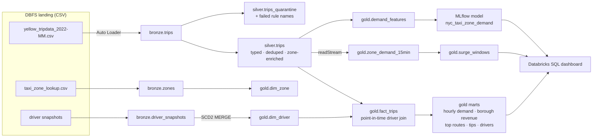

# NYC Taxi Lakehouse on Databricks

An end-to-end lakehouse for NYC yellow-taxi operations on **Databricks (DBR 12.0, Spark 3.3.1, Delta Lake 2.2)**:

- incremental ingestion with **Auto Loader**
- a medallion pipeline with declarative **data-quality rules** and quarantine tables
- an **SCD Type 2** driver dimension maintained with Delta `MERGE`
- a **star schema** with point-in-time joins
- **Structured Streaming** zone-demand windows with surge detection
- an **MLlib + MLflow** hourly demand-forecasting model
- the same trips pipeline expressed as **Delta Live Tables**
- orchestration as a 7-task **Databricks Workflow** deployed with `dbx`

All transformation logic is a plain Python package (`src/taxi_lakehouse`). The notebooks are thin wrappers
around it, so everything is unit-tested locally with PySpark and in CI.



## What's inside

| Area | Implementation |
|---|---|
| Ingestion | Auto Loader (`cloudFiles`) with `availableNow` trigger and checkpoints. Each monthly file is processed exactly once. |
| Data quality | 9 trip rules and 3 driver rules defined once as SQL strings (`quality.py`). Batch mode splits rows into valid and quarantine (with `_failed_rules`). DLT uses the same rules with `@dlt.expect_all_or_drop`. A workflow gate fails the run if the pass rate drops below 95%. |
| Deduplication | Deterministic `trip_id` = SHA-256 over every business column. Exact re-sent records collapse, and the Silver `MERGE` is idempotent. |
| SCD Type 2 | `dim_driver` tracks `vehicle_type`, `base_name` and `status` with `effective_from`, `effective_to` and `is_current`. Rating changes are type 1. Uses a single `MERGE` per snapshot with the staged-updates / null-merge-key pattern, plus a pure-DataFrame implementation for tests. |
| Star schema | `fact_trips` (partitioned by `pickup_date`, Z-ordered by zone) plus `dim_date`, `dim_zone` and `dim_driver`. Each trip joins to the driver version valid at pickup time. |
| Streaming | 15-minute tumbling windows per pickup zone with a 30-minute watermark. Surge = demand ≥ 1.5× the zone's normal level for that hour. The same function runs on streaming and batch DataFrames. |
| ML | Hourly pickups per zone on a zero-filled zone × hour grid. Features: calendar, lags (1h, 2h, 24h, 168h), rolling means, and a zone level target-encoded on the training window only. Time-based split. Spark MLlib `GBTRegressor`, logged and registered in MLflow. |
| DLT | `dlt/taxi_dlt_pipeline.py`: Bronze → Silver (with expectations) → Gold. |
| Orchestration | `conf/deployment.yml`: a 7-task workflow with separate ETL and ML job clusters, deployed with `dbx`. |
| Testing | 26 pytest tests on a local SparkSession. GitHub Actions runs the tests and an end-to-end smoke run on Python 3.9 / Java 11, matching DBR 12.0. |

## Results (local run, 60k trips, Oct–Dec 2022)

The data is **synthetic**. It follows the TLC yellow-taxi schema, adds a `driver_id`, and includes realistic
demand curves, fares, and deliberately injected bad records (see `data_generator.py`).

**Data quality**

| Dataset | Raw rows | Exact duplicates | Valid | Quarantined | Pass rate |
|---|---:|---:|---:|---:|---:|
| trips | 60,214 | 214 | 58,109 | 1,891 | 96.9% |
| driver snapshots | 832 | 0 | 830 | 2 | 99.8% |

Top trip rule failures: `passenger_count_1_to_6` (576), `distance_positive` (541), `known_pickup_zone` (292),
`fare_non_negative` (255), `plausible_speed` (242), `duration_1min_to_4h` (227), `dropoff_after_pickup` (189).

**SCD2 driver dimension**: 478 rows, of which 430 are current and 48 are closed historical versions. All 58,109
fact trips resolved to the correct driver version.

**Demand forecast** (36 zones × 2,040 hours = 73,440 rows; test set from 2022-12-10)

| Model | RMSE | MAE |
|---|---:|---:|
| Same hour last week (baseline) | 1.261 | 0.815 |
| Same hour yesterday (baseline) | 1.266 | 0.819 |
| **GBT (MLlib)** | **0.898** | **0.639** |

The GBT cuts RMSE by **29%** and MAE by **22%** compared with the best naive baseline. The top features are
`hour` (0.38), `zone_avg_demand` (0.26) and `day_of_week` (0.08).

**Revenue by pickup borough**: Manhattan $1.65M (52k trips), Queens $316k (4.7k trips, mostly
JFK and LaGuardia), Brooklyn $60k, Newark Airport $46k.

## Repository layout

```
src/taxi_lakehouse/
  config.py          paths, databases, constants (airports, payment types, holidays)
  schemas.py         raw schemas (TLC trip records, zones, driver snapshots)
  data_generator.py  synthetic 3-month dataset with injected quality issues
  bronze.py          batch + Auto Loader readers with lineage columns
  silver.py          typing, derived metrics, dedupe, zone enrichment
  quality.py         rules, quarantine split, reports
  scd2.py            SCD2 apply, MERGE staging, point-in-time join
  gold.py            dimensions, fact_trips, marts
  streaming.py       windowed zone demand, surge detection
  features.py        zero-filled demand grid + lag/calendar features
  ml.py              time split, target encoding, GBT training, MLflow logging
  pipeline.py        local end-to-end runner
notebooks/           00_setup → 07_data_quality (Databricks source format)
dlt/                 Delta Live Tables pipeline
conf/                dbx workflow (deployment.yml), DLT settings
sql/dashboard.sql    queries behind the Databricks SQL dashboard
tests/               pytest suite
```

## Running on Databricks

1. Add the repo under **Repos** and attach a DBR 12.0 cluster (use DBR 12.0 ML for notebook 06).
2. Run `notebooks/00_setup` to create the `nyc_taxi_bronze`, `nyc_taxi_silver` and `nyc_taxi_gold` databases and land the data.
3. Run notebooks `01` → `07`, or deploy the workflow:
   ```bash
   dbx deploy nyc-taxi-lakehouse --assets-only
   dbx launch nyc-taxi-lakehouse --from-assets
   ```
4. Optional: create a DLT pipeline from `conf/dlt_pipeline.json`.

## Running locally

Requires Python 3.9 or 3.10 and Java 8, 11 or 17.

```bash
python3.10 -m venv .venv && source .venv/bin/activate
pip install pyspark==3.3.1 numpy pytest==7.2.0
pytest -q
PYTHONPATH=src python -m taxi_lakehouse.data_generator --output data/raw
PYTHONPATH=src python -m taxi_lakehouse.pipeline --local
```

## Tech stack

Databricks · Apache Spark 3.3 (PySpark, Structured Streaming, MLlib) · Delta Lake · Auto Loader ·
Delta Live Tables · MLflow · Databricks Workflows · dbx · Databricks SQL · pytest · GitHub Actions
